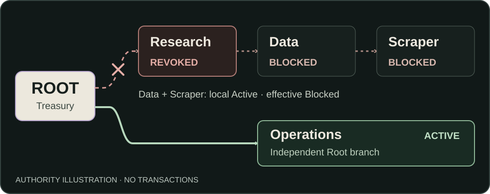

# MandateOS

**DON'T GIVE AGENTS WALLETS. GIVE THEM MANDATES.**

Recursive financial authority for agent organizations, enforced on Solana. One treasury. Bounded delegation. One cut that blocks a branch while independent operations continue.

`Solana Devnet` · `Rust / Anchor` · `TS SDK`

**[Live Demo](https://mandateos-protocol.vercel.app/) · [Technical Demo](https://youtu.be/h_Qn1jujxw8) · [Devnet Proof](#verify-the-chain-proof)**

[Quick Start](#quick-start) · [SDK](packages/sdk/README.md) · [Documentation](docs/README.md)

**Devnet MVP.** Demo and public account reads need no wallet. [Colosseum project](https://colosseum.com/arena/projects/mandateos).

## Why organizational authority?

An agent can delegate a job to another agent. Its financial permissions should follow that relationship.

A wallet balance or an isolated spending cap does not describe who delegated authority or which ancestors must remain valid. When Research delegates to Data, then Scraper, revoking Research should block that whole chain after a compromise. Operations should keep working.

MandateOS is built for developers who need that hierarchy around shared capital. The agent decides what to do; the protocol determines whether it has authority to spend.

## How MandateOS works

1. **Keep capital in one vault.** An organization has a program-controlled classic SPL token vault and a Root mandate. Child mandates reserve accounting authority; they are not separately funded wallets.
2. **Delegate bounded permissions.** A controller grants a child part of its available capacity. Each mandate records its controller, parent, depth and budget. Delegation can continue to the configured maximum depth, up to four levels below Root.
3. **Enforce the complete path.** A spend checks the signer and every ancestor through Root, then transfers tokens and updates accounting atomically. Revoking a parent invalidates its descendants' effective authority without enumerating them.

Revocation releases unused branch authority to its parent; it does **not** itself move tokens. [Protocol and accounting invariants](docs/PROTOCOL.md).

## ONE CUT



**Authority semantics — an illustration, not a transaction receipt.** [Editable SVG](docs/media/one-cut.svg).

**Scraper: locally Active, effectively Blocked.** Its account still exists, but its authority path crosses revoked Research. Operations has a different path and remains usable.

These names illustrate an organization, not built-in AI agents. Demo also includes Analysis; the historical Devnet fixture has five mandates.

### See ONE CUT in the product


**SIMULATED DEMO — no transactions.** The GIF joins six actual browser captures. [Try the interaction](https://mandateos-protocol.vercel.app/) · [Still image](docs/media/demo-cascade-still.png).

## Verify the chain proof

**Historical finalized CLI transactions on Solana Devnet.** These receipts show program enforcement; the GIF and current read-only example did not submit them.

| Proof    | Recorded outcome                  | Receipt                                                                                                                                                |
| -------- | --------------------------------- | ------------------------------------------------------------------------------------------------------------------------------------------------------ |
| Ancestry | **`AncestorRevoked / 6003`**      | [Failed spend](https://explorer.solana.com/tx/2ACUqFQ5zb66UdhCnxp6F8e6JMSiDQyNf7WURfa3DuhnSwkcgyiz2DCk42R19ZvSYKrExWnJ41PC9SW5uiSJmmgv?cluster=devnet) |
| Sibling  | Operations: **5 test SPL tokens** | [Spend](https://explorer.solana.com/tx/4BwMQJXxy3WagC8nm2p5mPQhtg1HJF3H6xYRESU9gFP9sTr96NLXKoSiK95WToCjqUamC4BPSYSu6m6G65QF18FZ?cluster=devnet)        |
| Arena    | Winner: **25 test SPL tokens**    | [Settlement](https://explorer.solana.com/tx/2F1Ukc4haw5PhmWZi6wLQtMqLYgH5cW4axH941gXKSiYpnrR72KoNrf3x66V5a9BbQM6GXtRAkiCMv8Dyw1QpET1?cluster=devnet)   |

**Test SPL tokens, not USDC. Historical execution, not autonomous AI payments.**

[Deployed program](https://explorer.solana.com/address/125ZLPqLmkg1fuyLzAxfKGXkT2tfxnNqyGrtHyjgDCUd?cluster=devnet) · [Historical organization](https://explorer.solana.com/address/EJsA5n6BBusygH8Ze9pktPFbpP2FXGEEBBgcE6A2Dz3A?cluster=devnet) · [Exact accounts and receipts](docs/DEVNET-MVP-VERIFICATION.md) · [Machine-readable proof](docs/devnet-mvp-proof.json).

Preserved release evidence records **64 local-validator integration tests: 48 Core + 16 Arena**. SDK/worker tests separately exercise client behavior with RPC stubs. [Verification boundaries](docs/MVP-STATUS.md).

## Implemented today

| Surface          | What is in the repository                                                                                                                                       |
| ---------------- | --------------------------------------------------------------------------------------------------------------------------------------------------------------- |
| Core protocol    | Organization creation, deposit, recursive delegation, spend, branch revoke and Root reclaim. Full ancestry and checked accounting.                              |
| Arena Lite       | Reserve a bounty, submit a result commitment, trusted-verifier settlement to the recorded winner. [Inspect Arena](https://mandateos-protocol.vercel.app/arena). |
| Operator console | Story simulation, public Devnet inspection, authority traces, permission guards and transaction construction. Native owner signing remains an acceptance gate.  |
| TypeScript SDK   | Account reads, effective-authority derivation, instruction builders, structured errors and transaction-outcome reconciliation.                                  |
| Reference worker | Real read-only Devnet CLI and integration code for an approved spend. Payment tests use stubs. No LLM or autonomous-payment CLI.                                |

## Why Solana

**Authority is checked where capital moves.** Program-owned mandate accounts and a PDA-controlled vault make the hierarchy enforceable independently of the agent or UI.

**Accounting and transfers succeed together.** SPL Token CPI and mandate updates happen in one transaction; a failed instruction rolls back its changes. A cached SDK read cannot bypass a later ancestor revocation.

**Applications share the same primitive.** Arena demonstrates treasury-backed reward reservation and atomic settlement through the existing vault. It is an implemented composability example, not a claimed integration with another protocol.

## Architecture and trust boundaries


The external agent is an integrator's component. MandateOS does not supply an LLM.

| Responsibility          | Boundary                                                                                                                            |
| ----------------------- | ----------------------------------------------------------------------------------------------------------------------------------- |
| Agent / operator        | Proposes work or an action. A decision grants no financial permission.                                                              |
| Execution service + SDK | Reads accounts, derives authority and builds instructions with canonical ancestry.                                                  |
| Legitimate controller   | Approves and signs through a caller-supplied wallet. Connect alone confers no controller rights.                                    |
| RPC + Solana program    | RPC forwards the signed transaction. The program checks current authority and atomically updates mandates and the shared SPL vault. |
| Public inspection       | SDK and console read state without a wallet. A snapshot is an observation, not a guarantee of later execution success.              |

The worker stops before signing when ancestry is blocked. Reconcile an unresolved transaction outcome before another attempt. [SDK lifecycle and errors](packages/sdk/README.md) · [Worker integration](examples/agent-worker/README.md).

## Stack

<details>
<summary>Pinned technologies and testing tools</summary>

Versions are pinned in the committed manifests, not claims about the latest releases.

| Layer          | Implementation                                                                                |
| -------------- | --------------------------------------------------------------------------------------------- |
| Program        | Rust 2021 edition; Anchor / anchor-spl **0.32.1**; classic SPL Token.                         |
| SDK            | TypeScript **5.9.3**; web3.js **1.98.4**; spl-token **0.4.14**. Node **≥20.18**.              |
| Web            | Next.js **16.3.8**, React **19.3.0**, Tailwind CSS **4.3.3**; static export.                  |
| Infrastructure | Vercel static hosting; direct Solana Devnet RPC. No application backend, indexer or database. |
| Tests          | Agave local validator; TypeScript / ts-mocha / Chai; focused SDK, worker and UI checks.       |

</details>

## Quick start

### 1. Try the hosted product

[Story / interactive Demo](https://mandateos-protocol.vercel.app/) → [Command / public Devnet](https://mandateos-protocol.vercel.app/app) → [Arena](https://mandateos-protocol.vercel.app/arena). No wallet is required for inspection. Story revocation is simulated; Devnet records and historical receipts are labeled separately.

### 2. Run a read-only SDK example outside this repository

**Node ≥20.18.** Download the [SDK tarball 0.1.0](https://mandateos-protocol.vercel.app/downloads/mandateos-sdk-0.1.0.tgz) and [runnable example](https://mandateos-protocol.vercel.app/downloads/inspect-devnet.mjs) into a new directory, then run:

```sh
npm init -y
npm install ./mandateos-sdk-0.1.0.tgz
node inspect-devnet.mjs
```

The example reads the real organization, traces Treasury → Research → Data → Scraper, and interprets the historical finalized 6003 receipt. Expected fixture: `local: active`, `effective: blocked`, Research as the blocking ancestor. State can change; RPC failures are reported. No key or transaction submission is involved.

**Downloadable tarball, not an npm-published package.** [Hashes](https://mandateos-protocol.vercel.app/downloads/manifest.json) · [Example source](examples/inspect-devnet.mjs) · [SDK API](packages/sdk/README.md).

<details>
<summary>The actual exported API — minimal Node ESM example</summary>

```js
import { PublicKey } from "@solana/web3.js";
import sdk from "@mandateos/sdk";
const { MandateClient, PROGRAM_ADDRESS, inspectAuthority } = sdk;
const client = new MandateClient({
  cluster: "devnet",
  rpcUrl: "https://api.devnet.solana.com",
  programId: PROGRAM_ADDRESS,
});
const snapshot = await client.load(
  new PublicKey("EJsA5n6BBusygH8Ze9pktPFbpP2FXGEEBBgcE6A2Dz3A"),
);
const authority = inspectAuthority(
  snapshot,
  new PublicKey("H8esVNCEEjoXTzryxfha8bB6USacX9SJihq22Knv3ytB"),
);
console.log(authority.local, authority.effective);
```

Incomplete or invalid ancestry yields unknown authority, not fabricated Active status. Set `MANDATEOS_RPC_URL` for the downloadable example if needed; keep private RPC credentials out of frontend configuration.

</details>

### 3. Develop locally and run focused checks

```sh
git clone --branch docs/github-launch https://github.com/luzzwaix/mandateos-v2.git
cd mandateos-v2
npm ci
npm ci --prefix web
npm run build --prefix web
npm run start --prefix web
```

Open `http://localhost:3000`. The web build also builds the SDK and prepares its downloads. [Environment configuration](web/.env.example).

From a second terminal at the repository root:

```sh
npm run typecheck
npm run test:ui
npm run agent:inspect
npm run check:secrets
```

`agent:inspect` builds SDK/worker and performs public reads only. For program builds, real validator tests (`npm run test:local`) and SDK/worker tests, follow [development instructions](docs/DEVELOPMENT.md) and [contribution checks](CONTRIBUTING.md). Binary-dependent tests require documented build artifacts; an old ELF must not be called a fresh build.

## Repository map

| Start here                     | Source / documentation                                                                                       |
| ------------------------------ | ------------------------------------------------------------------------------------------------------------ |
| Onchain program and invariants | [Program](programs/mandateos/src/lib.rs) · [Protocol](docs/PROTOCOL.md)                                      |
| Developer integration          | [SDK](packages/sdk/README.md) · [Reference worker](examples/agent-worker/README.md)                          |
| Product                        | [Web application](web/src/app/layout.tsx)                                                                    |
| Verification and scope         | [Devnet evidence](docs/DEVNET-MVP-VERIFICATION.md) · [Current MVP status](docs/MVP-STATUS.md)                |
| Setup and collaboration        | [Development](docs/DEVELOPMENT.md) · [Contributing](CONTRIBUTING.md) · [Documentation index](docs/README.md) |

## Roadmap

Core, Arena and the developer surfaces above are implemented. **Next — planned, not yet verified or delivered:**

- Complete a fresh owner-controlled browser lifecycle with native wallet signing.
- Harden dependency and operational security, then commission an independent security review.
- Validate SDK integrations and customer needs with teams building multi-agent organizations.

Mainnet and production readiness are not claimed. These are plans, not delivery dates or evidence of adoption.

## Founder and Colosseum

**Esentay Alikhan — Solo Founder & Builder**

Information Technology student at **Kazakh-British Technical University (KBTU)**, based in **Almaty, Kazakhstan**.

I build across AI, blockchain infrastructure and autonomous systems. I created MandateOS independently for Colosseum Crypto World's Fair 2026: from an idea to a Devnet MVP with a deployed program, TypeScript SDK, web application and verifiable transaction evidence.

**Current focus:** validating developer demand, improving integrations and connecting with builders in the Solana ecosystem.

**Connect:** [Telegram](https://t.me/luzzw22) · [X / Twitter](https://x.com/aqalix461) · [GitHub](https://github.com/luzzwaix)

[Colosseum project](https://colosseum.com/arena/projects/mandateos) · [Founder pitch](https://youtu.be/yPkFv8z8qeY)

## Scope and security

- **Devnet MVP, unaudited.** No mainnet readiness, production security guarantee, customer traction or autonomous AI payment is claimed.
- **Action-specific signers.** Connect shares a public key; it grants no authority over someone else's organization. Native Connect is founder-reported; the full browser-signed owner lifecycle remains unverified.
- **Limited policy surface.** Classic SPL Token only; up to four delegation levels. Controllers can spend available authority to valid same-mint token accounts outside the vault; there is no recipient allowlist or proof-of-work requirement. Organization, program-upgrade and mint authorities remain trust assumptions.
- **Trusted Arena verifier.** Commitments do not prove quality. No bounty cancellation is implemented; an unavailable verifier can leave a reward reserved. Core revocation does not cancel independent Arena submission eligibility.
- **Evidence boundaries.** Demo is simulation; reads are snapshots; CLI receipts are historical. Worker payment tests use RPC stubs. Reconcile unknown transaction outcomes before retrying.

[Detailed limitations and dated dependency-audit results](docs/MVP-STATUS.md) · [Protocol trust assumptions](docs/PROTOCOL.md).

The source repository is public. **No project license has been chosen or added.** License selection remains a founder decision.
