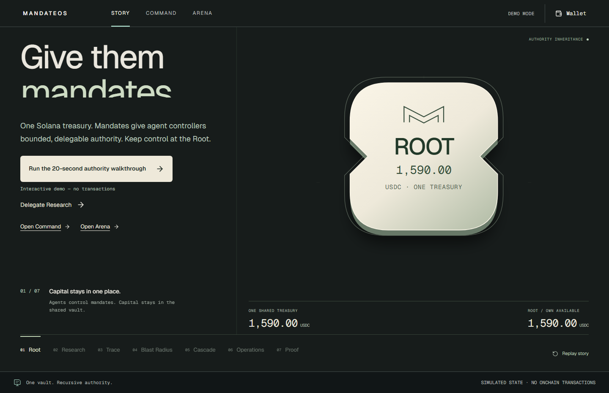
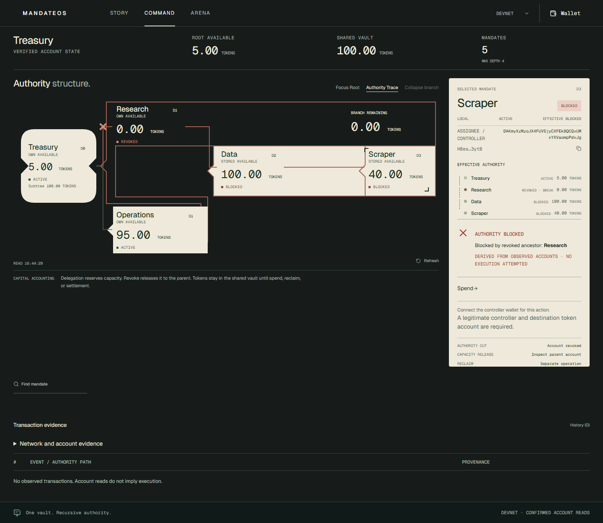
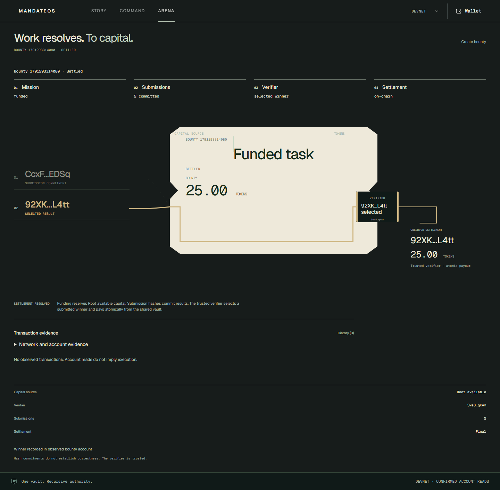

# MandateOS

**Don't give agents wallets. Give them mandates.**

MandateOS gives agents bounded, recursive economic authority on Solana: one shared treasury, a tree of mandates, and one revocation that cuts a branch's effective authority.

Built for teams giving autonomous agents spending authority. Solana enforces the complete ancestry and moves classic SPL tokens atomically; revoking a parent invalidates descendants without traversing or rewriting them. This is a Devnet MVP with a trusted Arena verifier. Browser Phantom signing and connected-wallet performance remain unverified.

[Recording runbook and complete founder script](RECORDING-RUNBOOK.md) · [Reproduce and publish the candidate](docs/OVERNIGHT-RELEASE.md). The generated local `MORNING-RELEASE-HANDOFF.md` is the current concise founder handoff. Demo is simulated; Devnet inspection displays actual accounts and historical receipts.



[Previous visual pass recording (before-state archive)](docs/images/completion/authority-walkthrough.webm). Illustrative Story USDC amounts are simulated; Devnet uses a classic SPL test mint, **not USDC**. [Previous capture and verification scope](docs/COMPLETION-SPRINT.md).

## Interact with authority

Use the direct Story actions to delegate Research, extend its hierarchy, trace Scraper, preview the affected subtree and confirm a demo revoke. Preview leaves every mandate active. The cut blocks descendants while Operations remains active; the selected authority record distinguishes local and effective status. Story submits no transactions. Use the navigation to open Command or Arena.

| Route            | Experience                                                                                                            |
| ---------------- | --------------------------------------------------------------------------------------------------------------------- |
| `/` · Story      | Authored simulation; no wallet or transactions.                                                                       |
| `/app` · Command | Real account reads, local/effective authority, available/reserved capital, eligible actions and transaction evidence. |
| `/arena` · Arena | Funded mission → submissions → trusted verifier → atomic winner payout.                                               |
| `/developers` · SDK | Download the independently consumable SDK tarball and exact runnable read-only Devnet example. Not published on npm. |

<table>
  <tr>
    <td><a href="docs/images/completion/command-devnet.png"></a></td>
    <td><a href="docs/images/completion/arena-devnet.png"></a></td>
  </tr>
</table>

These disconnected browser reads show the existing public fixture. They do not imply a browser transaction or a new settlement. Arena has a trusted verifier: a result hash commits bytes, not quality. Open bounties have no cancellation path.

## Live app and program

[Story](https://mandateos-v2.vercel.app/) · [Command](https://mandateos-v2.vercel.app/app) · [Arena](https://mandateos-v2.vercel.app/arena) · [Devnet program](https://explorer.solana.com/address/125ZLPqLmkg1fuyLzAxfKGXkT2tfxnNqyGrtHyjgDCUd?cluster=devnet).

Production was independently inspected through Vercel's deployment API during the overnight release sprint: deployment `dpl_6zwRZT42yGPaNsCVnPNJsAs6T3UN`, source `7ce740a585774eb195ef8626876ae4a3db9f9000`, READY. Production remains unchanged. The new candidate uses a separate non-production preview; its exact URL/SHA/access result belongs in the generated morning handoff, not this older production link. The project currently protects previews with Vercel SSO.

## Architecture and why Solana

```text
Next.js static app / reference worker / external integrator
                      │ shared TypeScript SDK + generated IDL
                      ▼ direct RPC
Solana program ── Organization + Mandate PDAs ── one classic SPL vault
               └─ Bounty + Submission PDAs ── verifier → winner token account

Treasury ── Research ── Data ── Scraper
        └── Operations
```

Agents sign as mandate controllers; they never receive the shared vault's key. The program validates the complete ancestry at execution, including revocation races. Delegation reserves only the parent's own available capital. Spending reduces remaining capital along the path. Revocation returns the branch reservation to the parent without traversing or mutating descendants and without moving tokens. A descendant can remain locally ACTIVE while effectively BLOCKED. Root reclaim is a separate instruction using only Root's own available capital.

Solana enforces those rules and transfers atomically against shared public state. Frontend animation, a backend or an agent's private memory cannot grant authority. There is no application API, indexer or database. [Protocol and accounting invariants](docs/PROTOCOL.md).

## Five-minute quickstart

Node ≥20.18. Install the pinned dependencies and copy only public example configuration if no local configuration exists:

```sh
npm ci
npm ci --prefix web
node -e "const fs=require('node:fs');if(!fs.existsSync('web/.env.local'))fs.copyFileSync('web/.env.example','web/.env.local')"
npm run build --prefix web
npm run start --prefix web
```

Open [local Story](http://127.0.0.1:3000/), [Command](http://127.0.0.1:3000/app) or [Arena](http://127.0.0.1:3000/arena). Command/Arena read the public organization without a wallet. Writing requires the actual authorized controller, Devnet SOL for fees and the organization's mint. Connecting grants no authority over the public fixture. Never put an RPC secret in `NEXT_PUBLIC_*` settings.

## SDK and reference agent

The candidate's **Integrate with SDK** entry opens `/developers`: download the package and [runnable example](examples/inspect-devnet.mjs) into a new directory, then run `npm init -y`, `npm install ./mandateos-sdk-0.1.0.tgz`, and `node inspect-devnet.mjs`. Node ≥20.18; no wallet or signing keys. It reads the actual organization, traces Scraper's ancestry and parses the actual historical finalized 6003 receipt. The web build generates both downloads from this checkout's SDK source; the package is **not published on npm**.

Your existing LLM or workflow proposes a job; your execution service calls MandateOS, a legitimate signer authorizes the transaction, and Solana checks limits and ancestry at execution. A prior read is not an execution guarantee. The reference worker has no LLM and stops before payment when authority is blocked.

After `npm ci`, run `npm run build:sdk`. Save this as `inspect.mjs`, then run `node inspect.mjs`:

```js
import { PublicKey } from "@solana/web3.js";
import {
  MandateClient,
  PROGRAM_ADDRESS,
  inspectAuthority,
} from "@mandateos/sdk";

const client = new MandateClient({
  cluster: "devnet",
  rpcUrl: "https://api.devnet.solana.com",
  programId: PROGRAM_ADDRESS,
});
const snapshot = await client.load(
  new PublicKey("EJsA5n6BBusygH8Ze9pktPFbpP2FXGEEBBgcE6A2Dz3A"),
);
const authority = inspectAuthority(
  snapshot,
  new PublicKey("H8esVNCEEjoXTzryxfha8bB6USacX9SJihq22Knv3ytB"),
);
console.log(authority.local, authority.effective); // current fixture: active blocked
```

The framework-independent SDK shares the app's generated protocol client. It supports Core/Arena builders, deployment verification, exact integer amounts, progress, typed transaction outcomes and read-only reconciliation. Mint/vault reads are batched with SPL and organization checks. Never blindly retry an unknown signature. [Authority model, SDK usage and errors](packages/sdk/README.md). For another project: `npm pack ./packages/sdk`, then install the resulting tarball.

The [reference worker](examples/agent-worker/README.md) has a runnable safe path:

```sh
npm run agent:inspect
```

It builds the SDK/worker, reads the real Scraper path and reports revoked ancestry. The caller-signed `runAuthorizedSpend` integration checks controller, amount and destination, attempts one supported spend and retains outcome evidence. There is no embedded secret or spending CLI. Live worker spending remains unverified.

## Evidence and limits

The existing **CLI-signed** canonical lifecycle covers funding, recursive delegation, spend, Research revocation, included failed descendant spend, surviving Operations spend, Root reclaim and Arena settlement. All 19 signatures were rechecked as finalized on 7 October 2026; current accounts matched the recorded lifecycle. **No new Devnet write was needed or submitted in this sprint.** [Full signatures, logs and balances](docs/devnet-mvp-proof.json) · [Lifecycle report](docs/DEVNET-MVP-VERIFICATION.md).

| Receipt                                                                                                                                                      | Provenance and outcome                                                |
| ------------------------------------------------------------------------------------------------------------------------------------------------------------ | --------------------------------------------------------------------- |
| [Blocked descendant](https://explorer.solana.com/tx/2ACUqFQ5zb66UdhCnxp6F8e6JMSiDQyNf7WURfa3DuhnSwkcgyiz2DCk42R19ZvSYKrExWnJ41PC9SW5uiSJmmgv?cluster=devnet) | Historical CLI; finalized included failure, `AncestorRevoked / 6003`. |
| [Operations spend](https://explorer.solana.com/tx/4BwMQJXxy3WagC8nm2p5mPQhtg1HJF3H6xYRESU9gFP9sTr96NLXKoSiK95WToCjqUamC4BPSYSu6m6G65QF18FZ?cluster=devnet)   | Historical CLI; finalized success after sibling revocation.           |
| [Arena settlement](https://explorer.solana.com/tx/2F1Ukc4haw5PhmWZi6wLQtMqLYgH5cW4axH941gXKSiYpnrR72KoNrf3x66V5a9BbQM6GXtRAkiCMv8Dyw1QpET1?cluster=devnet)   | Historical CLI; finalized success, 25 test-token payout.              |

Current mint: `6V3c3UWqXerQFyfVhFiWVMaXEjNPUmHwWsPa2c4TS1A9` (six decimals, classic SPL test TOKENS). Observed vault: 100 TOKENS; Root available: 5; Operations available: 95. Nested budgets are not additive vault capital.

The [completion report](docs/COMPLETION-SPRINT.md) records test scope, before/after measurements, screenshots and open gates. Real Phantom connection/signing and browser-signed lifecycle remain unverified because the accessible browser has no Phantom session. Native 200% browser zoom remains unverified; equivalent reflow is checked. Dependency remediation, security audit and production operations remain open. This is a Devnet release candidate, not a production-readiness claim.

[60–90 second recording script](docs/COMPLETION-RECORDING.md). No push, merge, preview deployment, program upgrade or production promotion is included in this checkpoint.
