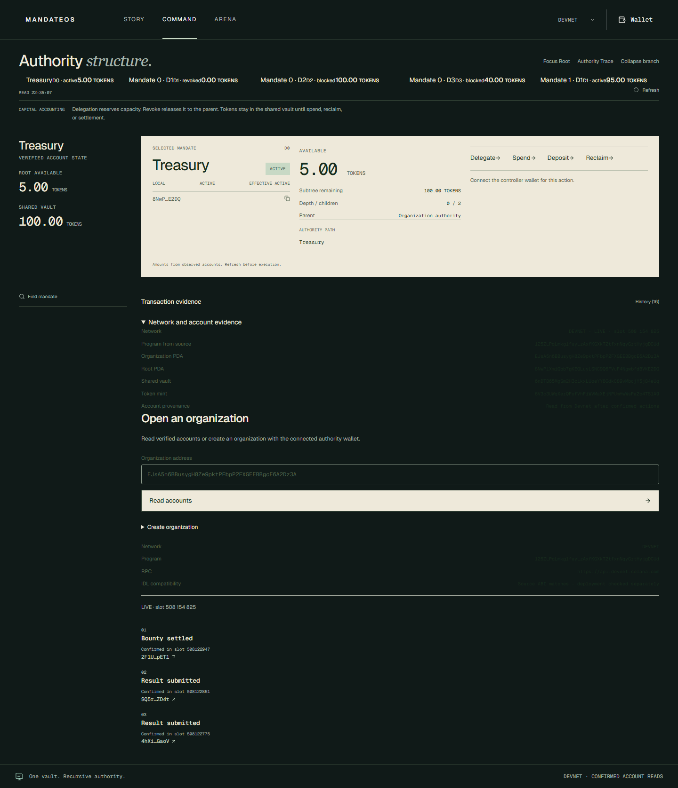
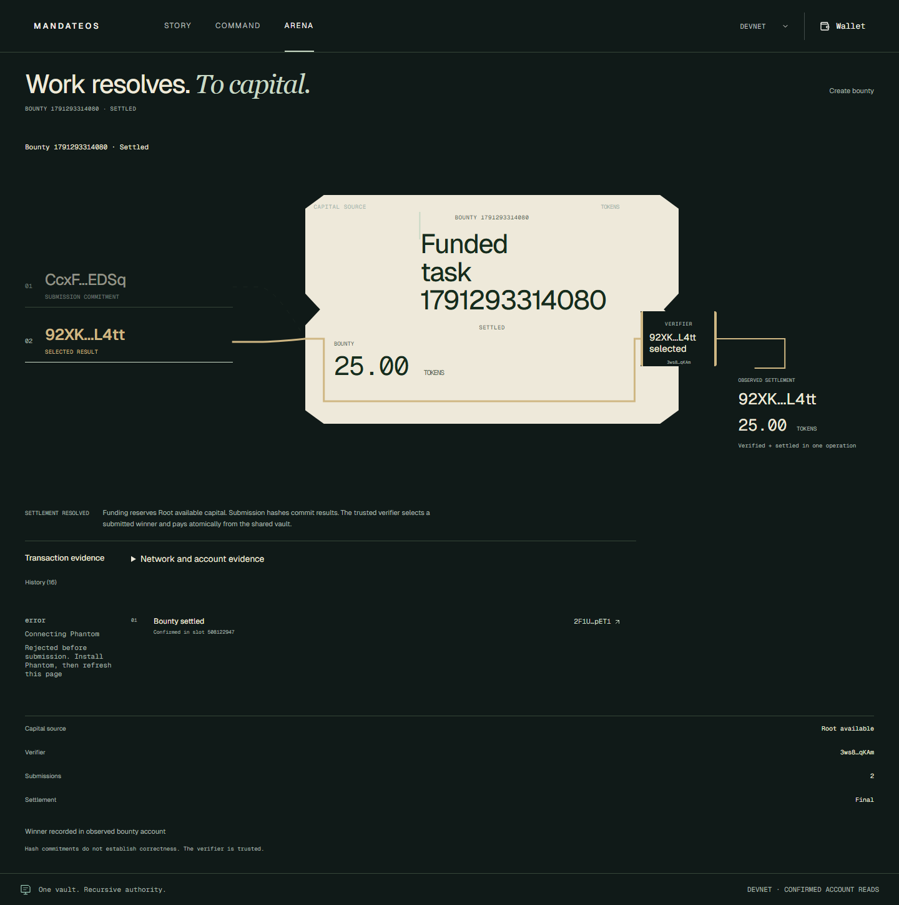
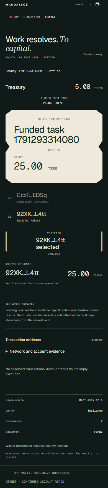

# MandateOS

**Don't give agents wallets. Give them mandates.**

MandateOS is recursive capital authority for autonomous organizations on Solana. An organization keeps tokens in one program-controlled vault, delegates bounded authority down an agent tree, and cuts an entire branch with one revocation transaction. Arena Lite reserves treasury capital for external work and pays one verified winner.

**Verified on Solana Devnet:** one treasury → nested delegation → valid spend → ancestor revoke → included failed descendant spend (`AncestorRevoked / 6003`) → successful Operations spend → Root-only reclaim. Existing Arena funding, two result commitments and atomic winner payout also finalized. All **19 lifecycle receipts** were independently reconciled; [actual signatures, fees, logs and balances](docs/devnet-mvp-proof.json) and [verification report](docs/DEVNET-MVP-VERIFICATION.md) are available.

[Public Devnet product](https://mandateos-v2.vercel.app/app) · [Arena](https://mandateos-v2.vercel.app/arena). Anonymous HTTP access is verified for all three routes; production no longer requires Vercel SSO. Real owner-wallet signing across a fresh organization remains an open release gate: existing lifecycle receipts were CLI-signed, not browser-signed. DEMO mode is explicitly simulated; Devnet never falls back to demo data after an RPC error.



## The problem

AI agents increasingly need authority to spend capital. Giving an agent a treasury key is unsafe. Flat spending limits break when agents delegate work to other agents.

## The primitive

```text
Human / one treasury
└── Research agent  400 test tokens
    └── Data agent  150 test tokens
        └── Scraper 50 test tokens

Revoke Research
→ Research revoked; Data and Scraper blocked
→ unused capital returns to Root authority
→ Root can reclaim tokens from the shared vault
```

Agents control signing keys, never the treasury key. Delegation moves accounting authority; tokens stay in the vault until an authorized payment or reclaim.

## Why Solana

Fast, low-cost transactions make delegation and revocation usable during agent execution. PDA authority controls the SPL vault without distributing its key. Transaction atomicity keeps payout and accounting consistent, including failed token transfers. Classic SPL Token accounts let organizations pay ordinary token recipients and Arena winners.

## Product

- **Core Organizations:** create, deposit, recursively delegate, spend, revoke branches and reclaim. Complete ancestor validation enforces authority at every depth.
- **Capital console:** a real Next.js desktop surface with a recursive capital tree, selected-mandate actions, wallet connection and decoded on-chain activity.
- **Arena Lite:** fund a bounty from Root available capital, collect one 32-byte commitment per agent, and let its trusted verifier settle one winner.

Arena's verifier is a trusted signer. A result commitment proves which hash an agent submitted; it does not prove useful work. Participant keys can also control mandates, but Arena eligibility is independent of branch authority. Open bounties have no cancellation path in this MVP; unavailable verifiers can leave rewards reserved.



## Quick start

From this integration checkout, use Node 20.18+ and preserve existing local settings:

```powershell
npm ci
npm --prefix web ci
if (!(Test-Path web/.env.local)) { Copy-Item web/.env.example web/.env.local }
npm --prefix web run build
$env:PORT="3101"
node scripts/web-preview.mjs
```

Open http://127.0.0.1:3101/app; Command and Arena default to DEVNET. Public reads load the canonical organization without a wallet. Its owner is 3ws8…; connecting another wallet grants no authority over it. The existing Create organization control accepts a verified classic SPL mint for your own treasury. Funding requires that mint in your source token account. Use injected Phantom/Solflare with a Devnet wallet. Never import the CLI deploy/upgrade key into the frontend.

The example environment contains only public RPC, Program ID and organization settings and disables disposable browser signing. HTTP pacing honors Retry-After; an unknown submission blocks further signing until reconciled. Do not put a paid RPC secret in NEXT_PUBLIC settings.

```powershell
# Read-only receipt/account verification; no keypair required:
npm run verify:devnet:read
```

Program **125ZLPqLmkg1fuyLzAxfKGXkT2tfxnNqyGrtHyjgDCUd**. Organization **EJsA5n6BBusygH8Ze9pktPFbpP2FXGEEBBgcE6A2Dz3A**. Classic SPL mint **6V3c3UWqXerQFyfVhFiWVMaXEjNPUmHwWsPa2c4TS1A9**, decimals 6: **test tokens, not USDC**. DEMO is separate and simulated. No validator or application backend is needed for the Devnet frontend.

| Flow                                            | Evidence status                                                                                |
| ----------------------------------------------- | ---------------------------------------------------------------------------------------------- |
| Treasury funding and recursive delegation       | Finalized on Devnet                                                                            |
| Valid Scraper spend and Research revoke         | Finalized on Devnet                                                                            |
| Blocked descendant action                       | Included finalized failure, Custom 6003, actual 10000-lamport fee                              |
| Operations spend / Root reclaim                 | Finalized on Devnet                                                                            |
| Arena commitments / trusted-verifier settlement | Finalized on Devnet, actual 25-token payout                                                    |
| Separate verifier-result / quality proof        | No such on-chain instruction                                                                   |
| Browser reads / Explorer evidence               | Public production reads and real Explorer links verified; adapter mocks are labeled separately |
| Real extension approval / pending → confirmed   | In progress; CLI signatures and adapter mocks do not substitute                                |
| Anonymous production frontend                   | Verified HTTP 200 on Story, Command and Arena; no cookies or authorization supplied            |

[Historical LOCALNET instructions](docs/README-LOCALNET-HISTORY.md) and their screenshots are preserved separately. Their ephemeral signatures are not Devnet evidence.

## One delegated controller action

This is a disposable CLI action, not an autonomous agent runtime. It uses the actual spend instruction and complete writable ancestor path; it cannot move vault tokens through an ordinary wallet transfer. Give a dedicated controller a mandate, retain the treasury key, and fund the controller with Devnet SOL for its fees. The utility refuses Root and a controller equal to the treasury authority.

The following command is read-only and was run against the existing active Operations mandate. It reads no key and sends no transaction:

```powershell
node scripts/mandate-spend.cjs --intent my-one-action --organization EJsA5n6BBusygH8Ze9pktPFbpP2FXGEEBBgcE6A2Dz3A --mandate HzDvZ6Bg4VS8PcizrmTFXG9kbmPqZdH5yK79wshmnn21 --destination 6z9Y84r9rDTtGQw8yzypX3vi8WTZ743hxw2ML2xWM79H --amount 1
```

To execute against your own mandate, replace the public addresses and append `--execute --keypair <protected-dedicated-controller-file-outside-the-repository>`. Do not export your connected browser wallet or supply its treasury key. Execution uses enabled preflight, saves simulation/signature/receipt before assertions and re-reads chain state. Reuse the **same intent name and parameters** to reconcile an unknown result; do not invent another intent to retry. The new wrapper's read-only path is verified; its execute path reuses the tested evidence transport but has not submitted a new spend in this release pass.

No backend is required for these supported instructions. Test-token provisioning and trusted-verifier selection remain operator responsibilities; neither is an autonomous service or an on-chain quality proof.

## Architecture

```text
Next.js static console / injected wallet or disposable LOCALNET signer
       │ real Anchor client + generated IDL
       ▼
Solana MandateOS program
├── Organization PDA ─── one classic SPL vault
├── Mandate PDAs ─────── Root → agent → delegated agent
└── Bounty + Submission PDAs ─── trusted verifier → winner SPL account
```

Rust remains modular: state, instructions, lineage validation, errors and events. The six Core instructions and existing Core account layouts are preserved. Arena adds only three instructions and two account types. The browser uses direct RPC; there is no database, authentication service, indexer or application backend. See [protocol/accounting](docs/PROTOCOL.md).

## Security invariants

**80 tests executed successfully: 48 existing Core validator tests, 16 Arena validator tests and 16 Rust tests.** The suites cover complete canonical lineage, ancestor revocation, reserved child and bounty capital, authorization, token ownership/mints, duplicate submissions/settlement, checked accounting and atomic rollback on failed token CPI.

Root remaining equals funded minus spent minus reclaimed. Bounty creation reduces only Root available, keeping escrow in the same vault; settlement reduces Root remaining and records spending atomically with payout. Reclaim cannot consume active child or bounty reservations.

This is an **unaudited hackathon MVP**. Controllers may choose arbitrary correct-mint recipients. Mint/freeze and upgrade authorities retain their configured powers. Pinned legacy client dependencies have audit advisories; no production-security claim is made.

## Development and verification

Pinned tools: Node 20.18+, Rust 1.89.0, Anchor 0.32.1, Agave 2.3.0, SBF platform-tools v1.52. Windows also requires Git Bash and Visual Studio x64 C++ tools; the existing scripts/setup-windows.ps1 configures user-local tools. Install these before running Rust/validator checks. The Devnet program is already deployed; do not redeploy to try the frontend.

```powershell
cargo fmt --all -- --check
cargo check --locked
cargo test --locked --lib
npm run typecheck
npm run test:local
npm run check:secrets
npm --prefix web run lint
npm --prefix web run typecheck
npm --prefix web run build
```

The local runner builds an isolated ignored source copy with disposable LOCALNET keys; it preserves the deployed ID and source semantics. Native Windows uses eight independent validator banks to avoid snapshot symlink limitations. Latest QA: **16 Rust unit cases**, **64 real validator cases**, **61 client/RPC/evidence/budget/UI unit cases** passed. Fresh SBF compilation passed; disk exhaustion blocked fresh IDL compilation, so the validator rerun reused the verified generated schema with its already-built isolated Localnet artifact. Exact provenance and measured performance are in [the final QA report](docs/FINAL-ADVERSARIAL-QA.md); historical Devnet receipts remain in [the verification report](docs/DEVNET-MVP-VERIFICATION.md).

Browser verification: node scripts/verify-devnet-browser.mjs http://127.0.0.1:3101. It requires an installed Playwright module (PLAYWRIGHT_MODULE can select it), performs actual read-only RPC checks, and separately labels adapter mocks. It never signs transactions. The existing capital-surface suite covers five viewport widths and reduced motion.

[Fresh browser fixture handoff](docs/DEVNET-BROWSER-HANDOFF.md) contains the owner approval, funded test-token account and exact expected UI sequence. The prepared 200 test TOKENS are not USDC. Public browser QA: 29 checks passed with read-only/mocked provenance recorded; mobile/reduced-motion production views: 13 checks passed. **No real browser-signed transaction is claimed.**

The final local QA candidate adds 33 read-only/adapter/recovery browser checks, 111 surface assertions and 10 motion checks. It fixes receipt-cache churn, blocking history reads and real-PDA evidence/layout defects. These changes are **not yet published to the public URL**; owner review and genuine browser-wallet approvals remain release gates. The fresh dependency audit reports 12 runtime advisories (5 high, 7 moderate); no forced SDK migration was made. See the QA report for screenshots, exact provenance and remaining checks.



## Release boundaries

Program/source/IDL identity and executable bytes are verified. Core and supported Arena flows have finalized receipts. Anonymous production access and account/evidence reads are verified. Real Chrome wallet approval/signing across a fresh organization and authority recovery-backup verification remain open gates. Public dependency audit reports 12 runtime advisories (5 high, 7 moderate); no forced SDK migration or security-audit claim is made.

The frontend visual checkpoint remains frozen. No backend, database, x402, mainnet usage, new feature surface or another Solana deployment was added. Current work is on devnet-integration; GitHub publication and submission video follow product verification. No push or merge has been performed.
