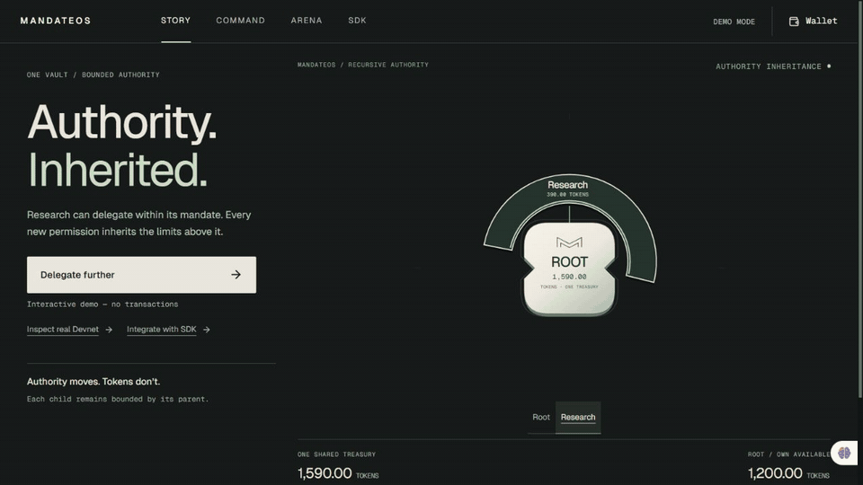

# MandateOS

**One treasury. Delegated authority. A branch you can revoke.**

MandateOS is a Solana-enforced authority system for developers building autonomous agent organizations. Delegate limited financial permissions through a hierarchy; revoke a parent and its descendants lose effective authority, while independent siblings continue.

**[Try Demo](https://mandateos-protocol.vercel.app/) · [Inspect real Devnet](https://mandateos-protocol.vercel.app/app) · [Integrate the SDK](https://mandateos-protocol.vercel.app/developers)**

Demo and public Devnet reads work without connecting a wallet.

## One cut. Control stays.

**SIMULATED DEMO · No transactions.** Actual browser-captured product states: delegation → ancestry trace → revoke preview → blocked Scraper → surviving Operations. This GIF joins six captured states; it is not onchain execution footage.



[View a still image](docs/media/demo-cascade-still.png) · [Open the interactive Demo](https://mandateos-protocol.vercel.app/)

Research delegates to Data; Data delegates to Scraper. Operations is a separate Treasury child. Revoking Research leaves Scraper **locally Active, effectively Blocked**. The account remains; its permission to execute does not.

## Authority is enforced where capital moves

Allocations reserve accounting authority in **one shared SPL token vault**, rather than creating separate agent wallets. A spend validates the complete ancestry and updates accounting along that path atomically. Revocation releases the branch reservation; it does not itself transfer tokens.

Solana makes limits, ancestry and settlement enforceable by the program. The SDK explains a snapshot; the program decides whether execution is allowed when a transaction lands.

## Built for your existing agents


**External AI Agent → Execution Service → MandateOS SDK → Solana Program → Authority Outcome**

Your agent proposes an action. Your execution service calls the SDK. A legitimate signer approves the transaction; Solana validates authority. The [reference worker](examples/agent-worker/README.md) is **not an LLM**. Its CLI performs read-only inspection; its authorized-payment tests use stubs, not autonomous Devnet payments.

### Run the SDK outside this repository

Requires **Node ≥20.18**. Download both files into a new directory:

- [SDK tarball — 0.1.0](https://mandateos-protocol.vercel.app/downloads/mandateos-sdk-0.1.0.tgz)
- [Runnable read-only example](https://mandateos-protocol.vercel.app/downloads/inspect-devnet.mjs)
- [Download hashes](https://mandateos-protocol.vercel.app/downloads/manifest.json)

```sh
npm init -y
npm install ./mandateos-sdk-0.1.0.tgz
node inspect-devnet.mjs
```

This is a tarball distribution, **not a published npm package**. The [committed example](examples/inspect-devnet.mjs) loads a real organization, traces Scraper ancestry and interprets a historical finalized receipt. No wallet or transaction submission is needed.

The actual exported API, with the package's CommonJS-compatible Node ESM import:

```js
import { PublicKey } from "@solana/web3.js";
import sdk from "@mandateos/sdk";
const { MandateClient, PROGRAM_ADDRESS, inspectAuthority } = sdk;

const client = new MandateClient({
  cluster: "devnet",
  rpcUrl: "https://api.devnet.solana.com",
  programId: PROGRAM_ADDRESS,
});
const snapshot = await client.load(
  new PublicKey("EJsA5n6BBusygH8Ze9pktPFbpP2FXGEEBBgcE6A2Dz3A"),
);
const authority = inspectAuthority(
  snapshot,
  new PublicKey("H8esVNCEEjoXTzryxfha8bB6USacX9SJihq22Knv3ytB"),
);
console.log(authority.local, authority.effective);
```

The fixture demonstrates Treasury → Research → Data → Scraper: local `active`, effective `blocked`, with Research as the invalid ancestor. Reads are observations; receipts below describe historical execution. If public RPC fails, set `MANDATEOS_RPC_URL` in your execution environment and retry the read. Never expose private RPC credentials in frontend configuration.

[SDK API and errors](packages/sdk/README.md) · [Reference worker](examples/agent-worker/README.md) · [Protocol specification](docs/PROTOCOL.md)

## Inspect the chain proof

**Historical finalized CLI transactions on Solana Devnet.** These receipts do not claim fresh browser or worker execution.

| Proof               | Verified outcome                                          | Explorer                                                                                                                                                         |
| ------------------- | --------------------------------------------------------- | ---------------------------------------------------------------------------------------------------------------------------------------------------------------- |
| Revoked ancestry    | Scraper spend rejected: `AncestorRevoked`, error **6003** | [Failed transaction](https://explorer.solana.com/tx/2ACUqFQ5zb66UdhCnxp6F8e6JMSiDQyNf7WURfa3DuhnSwkcgyiz2DCk42R19ZvSYKrExWnJ41PC9SW5uiSJmmgv?cluster=devnet)     |
| Independent sibling | Operations spend succeeded: **5 test tokens**             | [Successful transaction](https://explorer.solana.com/tx/4BwMQJXxy3WagC8nm2p5mPQhtg1HJF3H6xYRESU9gFP9sTr96NLXKoSiK95WToCjqUamC4BPSYSu6m6G65QF18FZ?cluster=devnet) |
| Arena settlement    | Recorded winner received **25 test tokens**               | [Settlement transaction](https://explorer.solana.com/tx/2F1Ukc4haw5PhmWZi6wLQtMqLYgH5cW4axH941gXKSiYpnrR72KoNrf3x66V5a9BbQM6GXtRAkiCMv8Dyw1QpET1?cluster=devnet) |

**Deployed program:** [`125ZLPqLmkg1fuyLzAxfKGXkT2tfxnNqyGrtHyjgDCUd`](https://explorer.solana.com/address/125ZLPqLmkg1fuyLzAxfKGXkT2tfxnNqyGrtHyjgDCUd?cluster=devnet)

These are classic SPL **test tokens, not USDC**. Demo includes an illustrative Analysis node; the historical Devnet organization has five mandates. [Account identifiers and verification](docs/DEVNET-MVP-VERIFICATION.md) · [Machine-readable receipts](docs/devnet-mvp-proof.json)

## Arena: authority meets work

[Open Arena](https://mandateos-protocol.vercel.app/arena) to inspect a funded mission, submissions, verifier and recorded settlement. A designated verifier selects submitted work; the program settles payment to the selected contributor. This is trusted verification, not an autonomous judging model.

## Verified scope and limitations

- **Program:** 64 local-validator integration tests passed in the preserved release baseline (48 Core + 16 Arena). [Release evidence](docs/DEVNET-RELEASE.md).
- **Developer surface:** independently consumable SDK, structured errors, ancestry validation and a read-only worker. [Verification details](docs/COMPLETION-SPRINT.md).
- **Demo:** simulation, no transactions. **Devnet:** real public reads and explicitly historical receipts.
- **Not verified:** native Phantom browser signing. Historical controller mismatch is separate from connection failure.
- **Dependency audit:** the fresh external SDK install reported 9 advisories (3 moderate, 6 high); the root install reported 15. Dependency remediation is pending; no dependency upgrades were made in this documentation pass.
- **MVP:** no production security audit, customer traction or production usage claimed. Arena has no bounty cancellation path. Reconcile unknown transaction outcomes before any new attempt.

## Run locally

Node ≥20.18. From this checkout:

```sh
npm ci
npm ci --prefix web
npm run build:sdk
npm run build --prefix web
npm run start --prefix web
```

Open `http://localhost:3000`. The static build prepares SDK downloads automatically. [web/.env.example](web/.env.example) documents configuration; defaults use Devnet. Demo and public reads require no wallet or private key.

For program development follow [documented release toolchain](docs/DEVNET-RELEASE.md) and the pinned toolchain. Relevant checks include `npm run typecheck`, `npm run test:sdk`, `npm run test:agent`, `npm run check:secrets`, and `git diff --check`. Validator tests require the documented Solana/Rust environment.

## Source, contribution and license

[Documentation index](docs/README.md) · [Contribution guide](CONTRIBUTING.md) · [Repository instructions](AGENTS.md)

The live app serves production source `f4b0b4de02d4bbe4264391e0da727108597d1459`. This documentation branch preserves that source; the separate local Phantom hotfix is not included.

The connected GitHub repository is currently **private**. Its remote default branch does not yet contain this production baseline or SDK. This local publication candidate includes the required source; no push, visibility change or release has been performed.

**No project license has been approved or added.** Public visibility does not itself grant an open-source license. A licensed open-source launch requires the owner's license decision.
