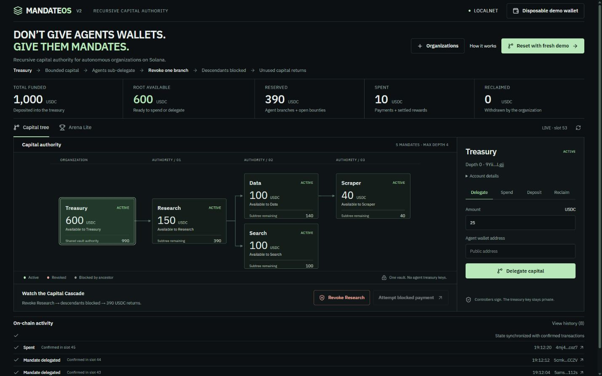
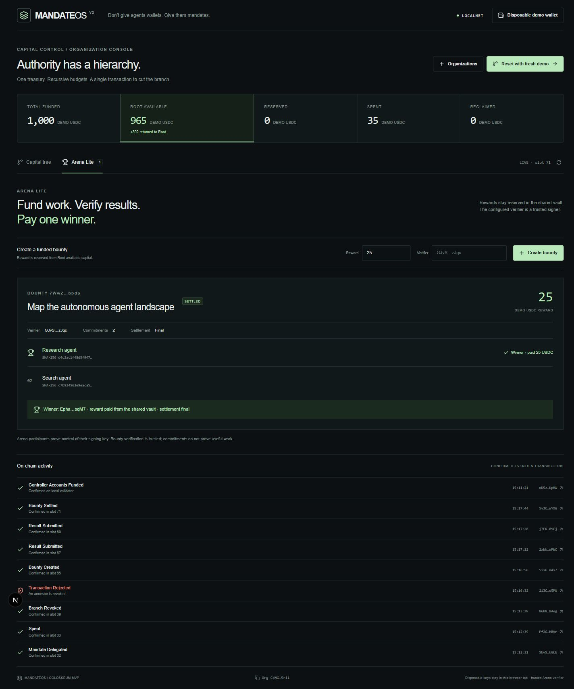

# MandateOS

**Don't give agents wallets. Give them mandates.**

MandateOS is recursive capital authority for autonomous organizations on Solana. An organization keeps tokens in one program-controlled vault, delegates bounded authority down an agent tree, and cuts an entire branch with one revocation transaction. Arena Lite reserves treasury capital for external work and pays one verified winner.

**Current integration:** frontend design is frozen. The authorized Devnet-only source/IDL identity is `125ZLPqLmkg1fuyLzAxfKGXkT2tfxnNqyGrtHyjgDCUd`; deployment is blocked by the unfunded dedicated Devnet payer. The real client uses all nine actual instructions and checks Devnet genesis plus deployed binary before transactions. DEMO remains visibly simulated. See [current release evidence](docs/DEVNET-RELEASE.md). The localnet screenshots, commands and Vercel preview below describe the historical `submission-v1.0.3` checkpoint; no current hosted Devnet lifecycle is claimed.

[Open the Vercel preview](https://mandateos-v2-qdi2zz8ve-luzzwaixs-projects.vercel.app) · **LOCALNET frontend**. A live validator is required for transactions; the hosted empty state is explicitly illustrative.



## The problem

AI agents increasingly need authority to spend capital. Giving an agent a treasury key is unsafe. Flat spending limits break when agents delegate work to other agents.

## The primitive

```text
Human / one treasury
└── Research agent  $400
    └── Data agent  $150
        └── Scraper $50

Revoke Research
→ Research revoked; Data and Scraper blocked
→ unused capital returns to Root authority
→ Root can reclaim tokens from the shared vault
```

Agents control signing keys, never the treasury key. Delegation moves accounting authority; tokens stay in the vault until an authorized payment or reclaim.

## Why Solana

Fast, low-cost transactions make delegation and revocation usable during agent execution. PDA authority controls the SPL vault without distributing its key. Transaction atomicity keeps payout and accounting consistent, including failed token transfers. Classic SPL Token accounts let organizations pay ordinary token recipients and Arena winners.

## Product

- **Core Organizations:** create, deposit, recursively delegate, spend, revoke branches and reclaim. Complete ancestor validation enforces authority at every depth.
- **Capital console:** a real Next.js desktop surface with a recursive capital tree, selected-mandate actions, wallet connection and decoded on-chain activity.
- **Arena Lite:** fund a bounty from Root available capital, collect one 32-byte commitment per agent, and let its trusted verifier settle one winner.

Arena's verifier is a trusted signer. A result commitment proves which hash an agent submitted; it does not prove useful work. Participant keys can also control mandates, but Arena eligibility is independent of branch authority. Open bounties have no cancellation path in this MVP; unavailable verifiers can leave rewards reserved.



## Demo

Start the validator and web console using the commands below. Click **Initialize local demo** and select the disposable wallet file printed by the runner. The file is read locally into tab memory; it is never uploaded, embedded in the bundle or persisted by the app. Import only that generated test wallet.

Setup sends real transactions: create a six-decimal demo SPL mint, fund Root with 1,000, delegate Research 400, Data 150, Search 100 and Scraper 50, then spend 10 from Scraper.

1. Root initially has 600 available; Research has 390 remaining.
2. Click **Revoke Research**. Wait for confirmation: Research becomes revoked, Data/Search/Scraper become blocked, and Root available rises to 990.
3. Click **Attempt blocked payment**. A real Scraper payment is broadcast and recorded as failed with `AncestorRevoked`; inspect its signature and logs.
4. Open **Arena Lite**. Create a 25-token bounty, submit Research and Search commitments, then select Research as winner.
5. Observe the confirmed payout and settlement event. Root has 965 available; total spending is 35.
6. Select Root → Reclaim → 965. The vault becomes zero; the owner receives 965.

[Recorded public RPC proof](docs/demo-proof.json) and [verification details](docs/VERIFICATION.md) document the completed browser flow. These addresses/signatures belong to an ephemeral **LOCALNET**, not devnet. Explorer custom-RPC links require that original validator to remain running.

## Architecture

```text
Next.js static console / injected wallet or disposable LOCALNET signer
       │ real Anchor client + generated IDL
       ▼
Solana MandateOS program
├── Organization PDA ─── one classic SPL vault
├── Mandate PDAs ─────── Root → agent → delegated agent
└── Bounty + Submission PDAs ─── trusted verifier → winner SPL account
```

Rust remains modular: state, instructions, lineage validation, errors and events. The six Core instructions and existing Core account layouts are preserved. Arena adds only three instructions and two account types. The browser uses direct RPC; there is no database, authentication service, indexer or application backend. See [protocol/accounting](docs/PROTOCOL.md).

## Security invariants

**80 tests executed successfully: 48 existing Core validator tests, 16 Arena validator tests and 16 Rust tests.** The suites cover complete canonical lineage, ancestor revocation, reserved child and bounty capital, authorization, token ownership/mints, duplicate submissions/settlement, checked accounting and atomic rollback on failed token CPI.

Root remaining equals funded minus spent minus reclaimed. Bounty creation reduces only Root available, keeping escrow in the same vault; settlement reduces Root remaining and records spending atomically with payout. Reclaim cannot consume active child or bounty reservations.

This is an **unaudited hackathon MVP**. Controllers may choose arbitrary correct-mint recipients. Mint/freeze and upgrade authorities retain their configured powers. Pinned legacy client dependencies have audit advisories; no production-security claim is made.

## Build

Use Node 20.18+, Rust 1.89.0, Anchor 0.32.1, Agave 2.3.0 and SBF tools v1.52. Native Windows additionally needs Git Bash and Visual Studio 2022 x64 C++ build tools. The Windows setup installs user-local official tools and SDK import libraries without changing global PATH.

```powershell
git clone --branch submission-v1 https://github.com/luzzwaix/mandateos-v2.git
Set-Location mandateos-v2
.\scripts\setup-windows.ps1
npm ci
npm --prefix web ci
npm run build:program
npm run test:local
```

On Linux/WSL, install those pinned tools first and omit the PowerShell setup command. The supported test runner creates isolated ignored wallets/deployments and leaves tracked source IDs unchanged. Native Windows runs eight independent real validator banks to avoid its snapshot symlink limitation.

In terminal A, from the repository root:

```powershell
npm run demo:local
```

It prints the funded disposable wallet path and actual program address. It creates `web/.env.local` with public localnet settings if absent; existing settings are preserved. Ensure the RPC and program match before starting the browser.

In terminal B:

```powershell
npm --prefix web run dev
```

Open [the local console](http://127.0.0.1:3000). Setup takes roughly two minutes on this native Windows configuration. Each confirmed action takes about eight seconds because slots are slowed to extend the recording window.

Native Agave 2.3 Windows can stop during snapshot archiving without symlink privileges (observed error 1314). Failure can occur after slot 100; it is not a fixed timer. The runner reports the failure and preserves the ledger. Start a fresh run and initialize a new organization for another recording; use WSL2 or a symlink-capable shell for uninterrupted sessions. The passing test runner avoids this limitation through isolated batches.

Final checks:

```powershell
cargo fmt --all -- --check
cargo check --locked
cargo test --locked --lib
cargo clippy --locked --all-targets -- -D warnings
npm run typecheck
npm run format:check
npm run check:secrets
npm --prefix web run typecheck
npm --prefix web run lint
npm --prefix web run build
npm --prefix web start
```

The last command previews the production **static export** at port 3000; stop the development server first. Build output is `web/out`. Public environment settings are compiled into the frontend, so rebuild after changing them.

## Status

- **LOCALNET:** compiled program, all tests, browser Capital Cascade, real failed descendant payment, Arena payout and reclaim verified.
- **DEVNET:** not deployed. CLI selects mainnet-beta and its configured wallet file is absent; no funded local devnet wallet was available.
- **Frontend:** production export verified and deployed to the Vercel preview above. The hosted build disables disposable signing and points to LOCALNET. A standalone live public demo still requires a reachable deployed program.
- **Repository:** private GitHub repository, submission work on `submission-v1`, original `main` and `core-v0.1.0` preserved.

See [two-laptop handoff](docs/HANDOFF.md) for exact clone/update routines and [deployment](docs/DEPLOYMENT.md) for frontend hosting and devnet continuation.
