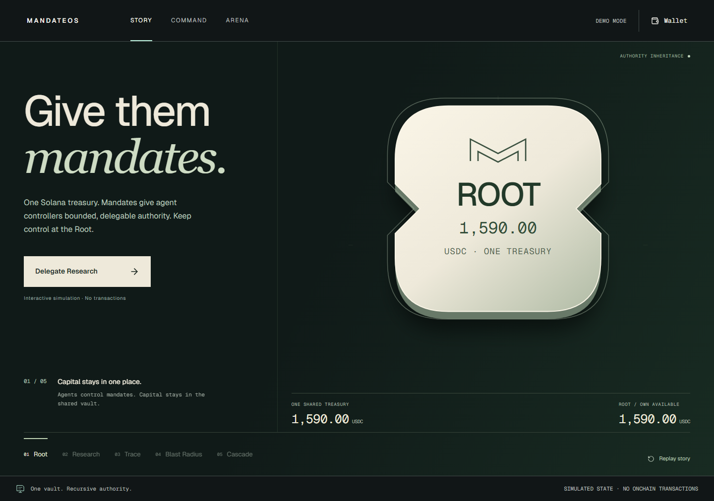
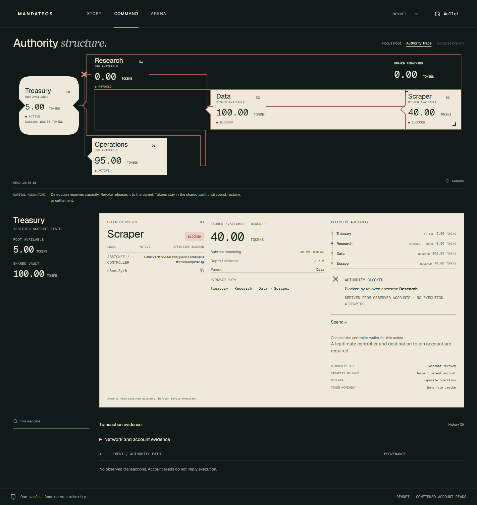
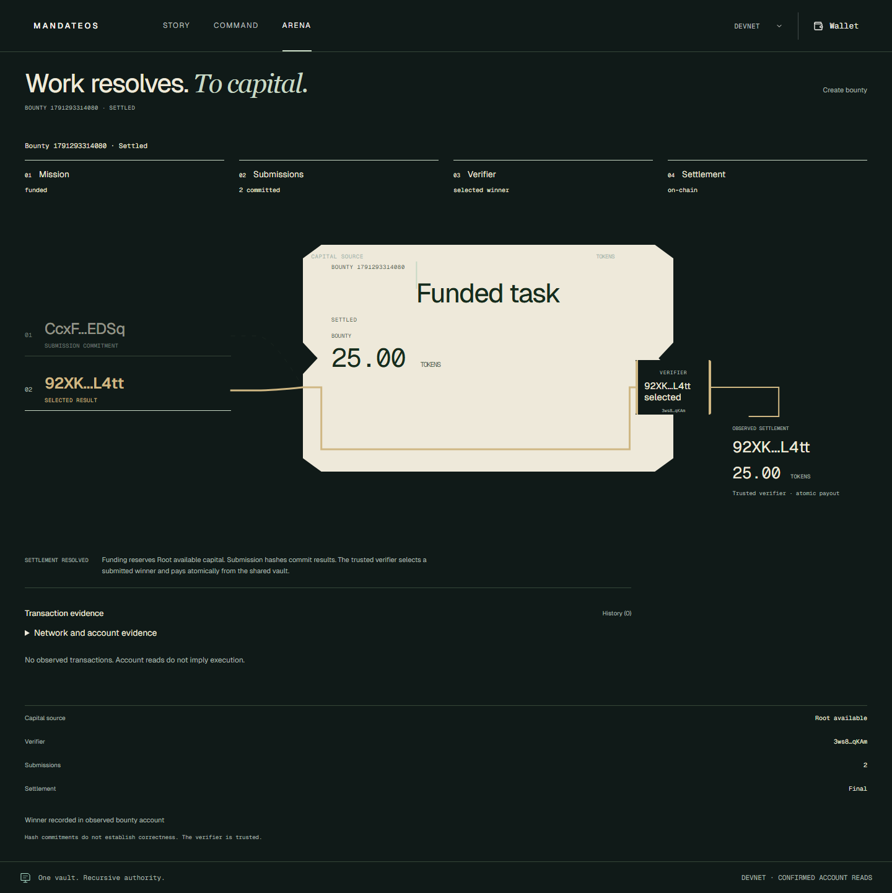

# MandateOS

**Don't give agents wallets. Give them mandates.**

An agent should be able to delegate a task without handing over the treasury. MandateOS gives agents bounded, recursive economic authority on Solana: one shared vault, a tree of mandates, and one revocation that cuts a branch's effective authority.



[Watch the short browser recording: grant → trace → revoke → surviving Operations](docs/images/showcase/authority-story.mp4). Story is an explicitly labeled simulation; its illustrative USDC amounts are not Devnet balances. These are captured application pixels, not mockups. [Capture provenance](docs/SHOWCASE-VERIFICATION.md).

## The primitive

```text
Treasury ── Research ── Data ── Scraper
        └── Operations

Revoke Research → Data and Scraper lose effective authority.
                  Operations remains active.
```

Agents sign as mandate controllers. They never receive the shared vault's key. Delegation reserves the parent's own available capital. Spending validates the complete ancestor path and reduces remaining capital along that path. Revocation releases the revoked subtree's reservation to its parent without traversing descendants or moving tokens. A descendant can remain locally Active while effectively blocked. Reclaim uses only Root's own available capital.

## What works today

This is a **Devnet MVP** with six Core instructions and three Arena instructions. The browser and framework-independent SDK share the source-generated protocol client.

| Route            | Experience                                                                                                                |
| ---------------- | ------------------------------------------------------------------------------------------------------------------------- |
| `/` · Story      | Interactive authority choreography: grant, recursion, trace, blast radius, cascade. Explicit simulation; no transactions. |
| `/app` · Command | Real account reads, ancestry, available versus reserved capital, mandate actions and transaction evidence.                |
| `/arena` · Arena | Treasury-funded mission → committed submissions → trusted verifier → atomic winner payout.                                |

<table>
  <tr>
    <td><a href="docs/images/showcase/command-devnet.webp"></a></td>
    <td><a href="docs/images/showcase/arena-devnet.webp"></a></td>
  </tr>
  <tr>
    <td>Command: stored-active Scraper, blocked by revoked Research.</td>
    <td>Arena: existing settled bounty, 25 test TOKENS.</td>
  </tr>
</table>

Both captures use actual disconnected Devnet account reads. Account observations do not imply a transaction was submitted through that browser. The fixture uses a six-decimal classic SPL test mint, **not USDC**. Arena trusts its verifier; a submission hash commits a result but does not prove quality. Open bounties have no cancellation path.

## Run the app

Node ≥20.18. From the repository root, install the pinned dependencies and copy only the public example configuration if no local configuration exists:

```sh
npm ci
npm ci --prefix web
node -e "const fs=require('node:fs');if(!fs.existsSync('web/.env.local'))fs.copyFileSync('web/.env.example','web/.env.local')"
npm run build --prefix web
npm run start --prefix web
```

Open [Story](http://127.0.0.1:3000/), [Command](http://127.0.0.1:3000/app) or [Arena](http://127.0.0.1:3000/arena). Command and Arena load the public organization without a wallet. Your wallet needs its own authorized organization/controller, Devnet SOL for fees, and the correct mint's tokens to write. Connecting alone grants no authority over the public fixture. No validator or backend is required. Never put an RPC secret in `NEXT_PUBLIC_*` settings.

## Integrate an agent

After `npm ci`, run `npm run build:sdk`. Save this as `inspect.mjs` and run `node inspect.mjs`:

```js
import { PublicKey } from "@solana/web3.js";
import {
  MandateClient,
  PROGRAM_ADDRESS,
  inspectAuthority,
} from "@mandateos/sdk";

const client = new MandateClient({
  cluster: "devnet",
  rpcUrl: "https://api.devnet.solana.com",
  programId: PROGRAM_ADDRESS,
});
const snapshot = await client.load(
  new PublicKey("EJsA5n6BBusygH8Ze9pktPFbpP2FXGEEBBgcE6A2Dz3A"),
);
const authority = inspectAuthority(
  snapshot,
  new PublicKey("H8esVNCEEjoXTzryxfha8bB6USacX9SJihq22Knv3ytB"),
);
console.log(authority.local, authority.effective); // current fixture: active blocked
```

The SDK loads organizations/mandates, validates deployment identity and canonical ancestry, and exposes `delegate`, `spend`, `revoke`, `reclaim`, `transact` and read-only `reconcileSubmission`. Evidence distinguishes preflight rejection, wallet rejection, submission, confirmed success, on-chain failure and unknown delivery. Never blindly retry an unknown signature. [Authority model, SDK usage and errors](packages/sdk/README.md). For another project: `npm pack ./packages/sdk`, then install the resulting tarball.

The [reference worker](examples/agent-worker/README.md) has one runnable, read-only command:

```sh
npm run agent:inspect
```

It builds the SDK/worker, reads the full Scraper path and reports revoked ancestry. Its caller-signed `runAuthorizedSpend` integration checks controller, amount and destination, attempts one spend, retains outcome evidence and refetches confirmed changes. No embedded secret or spending CLI. Live worker spending remains unverified.

## Architecture

```text
Next.js static app / reference worker / external integrator
                      │ shared TypeScript SDK + generated IDL
                      ▼ direct RPC
Solana program ── Organization + Mandate PDAs ── one classic SPL vault
               └─ Bounty + Submission PDAs ── verifier → winner token account
```

There is no database, indexer or application API. [Protocol and accounting invariants](docs/PROTOCOL.md).

## Evidence and boundaries

The existing CLI-signed Devnet lifecycle covers funding, recursive delegation, valid spend, Research revocation, an included failed descendant spend, surviving Operations spend, Root reclaim and Arena settlement. All 19 signatures were rechecked as finalized on 7 October 2026; the three receipts below were also fetched again and matched their recorded slots, fees and outcomes. [Full signatures, logs and balances](docs/devnet-mvp-proof.json) · [Lifecycle verification](docs/DEVNET-MVP-VERIFICATION.md).

| Receipt                                                                                                                                                      | Observed outcome                                                       |
| ------------------------------------------------------------------------------------------------------------------------------------------------------------ | ---------------------------------------------------------------------- |
| [Blocked descendant](https://explorer.solana.com/tx/2ACUqFQ5zb66UdhCnxp6F8e6JMSiDQyNf7WURfa3DuhnSwkcgyiz2DCk42R19ZvSYKrExWnJ41PC9SW5uiSJmmgv?cluster=devnet) | Included finalized failure, `AncestorRevoked / 6003`; 10,000 lamports. |
| [Operations spend](https://explorer.solana.com/tx/4BwMQJXxy3WagC8nm2p5mPQhtg1HJF3H6xYRESU9gFP9sTr96NLXKoSiK95WToCjqUamC4BPSYSu6m6G65QF18FZ?cluster=devnet)   | Finalized success after sibling revocation; 10,000 lamports.           |
| [Arena settlement](https://explorer.solana.com/tx/2F1Ukc4haw5PhmWZi6wLQtMqLYgH5cW4axH941gXKSiYpnrR72KoNrf3x66V5a9BbQM6GXtRAkiCMv8Dyw1QpET1?cluster=devnet)   | Finalized success, recorded 25-token payout; 5,000 lamports.           |

Program: `125ZLPqLmkg1fuyLzAxfKGXkT2tfxnNqyGrtHyjgDCUd`.

The implementation checkpoint passed 97 TypeScript cases (including 24 SDK and 10 worker cases), 64 real local-validator cases and 16 Rust cases. [Exact verification scope](docs/STARTUP-V1-DEVELOPER.md). A fresh source-only install, app/SDK/worker builds and real read-only SDK/agent paths were rerun for this showcase. [Current showcase checks](docs/SHOWCASE-VERIFICATION.md).

Remaining gates: real Phantom address/network/signing and connected-wallet performance; a fresh browser-signed lifecycle; live agent spending; security audit, dependency remediation and production operations. The accessible automation browser has no Phantom session. Historical CLI receipts and stubbed tests do not close those gates. [Measured performance fix and its limits](docs/STARTUP-V1-PERFORMANCE.md): receipt contention was removed; a general connected-wallet speedup has not been established.

## Where this runs

Verified on 7 October 2026. The showcase captures implementation `7350f67cafe3c29bedb2bc7c243b5288fc3d3a6c` on `startup-v1-lab`; this branch has **not** been deployed.

| Deployment                                                                                                                                             | Verified provenance                                                                                                                                                                        |
| ------------------------------------------------------------------------------------------------------------------------------------------------------ | ------------------------------------------------------------------------------------------------------------------------------------------------------------------------------------------ |
| [Production alias](https://mandateos-v2.vercel.app/) · [Command](https://mandateos-v2.vercel.app/app) · [Arena](https://mandateos-v2.vercel.app/arena) | Anonymous HTTP 200. Vercel source metadata: `7ce740a585774eb195ef8626876ae4a3db9f9000`; older product build.                                                                               |
| [Latest existing Vercel preview](https://mandateos-v2-f984ud67a-luzzwaixs-projects.vercel.app/)                                                        | Older `devnet-integration` preview, Vercel authentication required. Metadata: `f5b7965dbac9f4b634bfb5eccc6b146046218f68`, **dirty build**; SHA alone does not identify all deployed bytes. |

No automatic push, merge or production promotion is part of this checkpoint.
