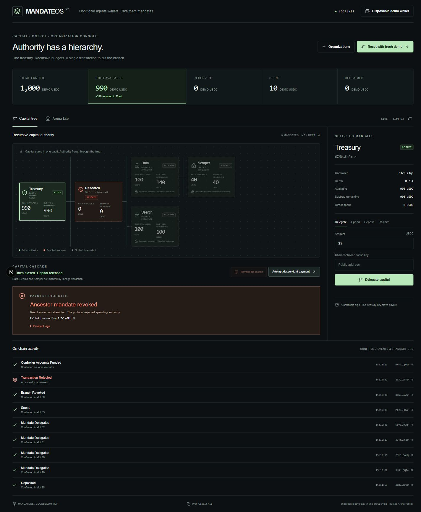

# Submission verification — 2026-10-02

## Executed checks

Windows laptop #1: Node 24.14.0, npm 11.9.0, Rust 1.89.0 GNU, Anchor 0.32.1, Agave 2.3.0 and SBF platform tools v1.52.

- Original baseline hash/tag/clean tree checked before changing source; minimum Core smoke passed.
- Rust fmt, Cargo check, Rust unit tests: **16 passed**, strict Clippy `-D warnings`: passed.
- Root `npm run typecheck`: passed.
- Root `npm run build:program`: actual Anchor SBF compilation + generated IDL passed.
- `npm run test:local` compiled the Arena extension; after fixing the settlement context's SBF stack overflow with boxed accounts, all **64 actual validator tests passed**, zero failed.
- Tests ran in eight independent native Windows banks, eight cases each. Existing Core tests remain 48; Arena contributes 16. Combined with Rust: **80 passing tests**.
- Frontend TypeScript, ESLint with zero warnings and optimized Next.js static export: passed.
- Production static-preview smoke also passed against the root build's default program address: actual mint/organization creation, deposit, all four delegations and initial spending completed. The validator later stopped at the documented slot-100 Windows snapshot limit; the UI correctly reported RPC unavailable.
- Frontend type checking generates Next route types first, so a clean clone does not require pre-existing ignored `.next` output.
- Final formatting, tracked-file secret/build-output exclusion and Git clean-tree checks: passed before push.

The passed validator run used ignored workspace `.localnet/run-1790930675171/workspace` at public program `4jugEx5VGfmpxsR2h8dFVXdQXwYmM34ypcm21ZWomnVf`. The source/default local demo uses the address from the root's generated IDL. No private deployment key is tracked for either.

Arena tests cover two submissions and exact payout, wrong creator/verifier, zero reward, active child/bounty reservation protection, duplicate submissions, non-submitter winners, redirected/wrong-mint payout, double settlement, submission after settlement, foreign-bounty submission, multiple reservations plus reclaim, and frozen-token CPI rollback. Existing complete lineage and canonical Core scenario tests remain intact.

## Real browser flow

The Next.js console was exercised at a 1440 × 960 desktop viewport, against the actual compiled program loaded in a real localhost validator. The disposable generated owner was imported through the visible file chooser. No browser application state was injected or blockchain response fabricated.

| Action                   | Confirmed result                                                                                          |
| ------------------------ | --------------------------------------------------------------------------------------------------------- |
| Demo setup               | Create mint/organization, deposit 1,000, Research 400, Data 150, Search 100, Scraper 50, Scraper spend 10 |
| Research revocation      | Root available 600 → 990, Research revoked, Data/Search/Scraper derived blocked                           |
| Descendant spend         | Actual ledger transaction failed, custom error 6003 / `AncestorRevoked`; no token payment                 |
| Arena create             | Root available 990 → 965; 25 reserved in the same vault                                                   |
| Submit Research + Search | Two independent 32-byte commitments stored                                                                |
| Verifier settlement      | Bounty Settled; Research token account receives exactly 25                                                |
| Root reclaim             | Owner receives 965; total spent 35, vault 0, Root available/remaining 0                                   |

Public organization: `CdNGJsGVWFfz7Eoz1bYXWQvBgWSAWv55w78kLyQj5ri1`.

- Revoke: `86h8PsAfjD3CmpFgk75GdKMknwrN9sKs3Xu8giDTqBLyQQ42T4x9ctmBeDrArV4EdfFkcGcd1jyKZCoVbQ58Aeg`, slot 39.
- Failed descendant payment: `2iJCNKex6XE36KhbfcvFqkffoSCNSBBNf4k6v2GSxBQhu99RVZbtSzSeA7cEA36nkwUhJAgKYSpdHijpXUwCo5PU`, slot 62.
- Settlement: `5vJCB6RKmRH3qyzWyQBMua6QUKFCVf1V2R3Z6UTHAFSSnNtsXGX4Tjr38VSyQAVjfRry1B2xSDfspqJ1pamtwYX6`, slot 71.
- Reclaim: `58C1GeMcyChYMnD7xhz6crMtmjY65zHuYx4vcsXHYen7hQfN6YYp7qcLunyfwywEy3GSoHQQHn3iq6MT5CfCox9c`, slot 76.

`node scripts/verify-demo.mjs 4jugEx5VGfmpxsR2h8dFVXdQXwYmM34ypcm21ZWomnVf` completed with exit 0 after the browser flow. It independently decodes public accounts, checks winner/owner/vault balances, accounting, valid submissions and the actual rejected transaction's Anchor logs. [Saved JSON](demo-proof.json) contains only public addresses, signatures and balances. A fresh demo produces new addresses and signatures; this proof is an ephemeral local ledger, not a persistent devnet deployment.

## Limits of verification

Injected Phantom/Solflare connection and signing adapters are implemented; no external extension is installed in the controlled browser, so its approval/signing flow was not exercised. Actual wallet signing and confirmation were exercised using the disposable local signing wallet.

The Windows SDK has an empty syscalls metadata file and warns during SBF post-processing; the validator successfully executed PDA derivation, logs and SPL CPIs. Legacy Anchor/SPL client dependencies have npm audit advisories. No force downgrade or unsupported protocol-library upgrade was applied.

No devnet deployment or public frontend hosting is claimed. Native Windows snapshot symlink error 1314 remains an environment limitation for long validator sessions. It does not invalidate completed confirmed transactions or the passing independent test banks. This MVP is unaudited.
